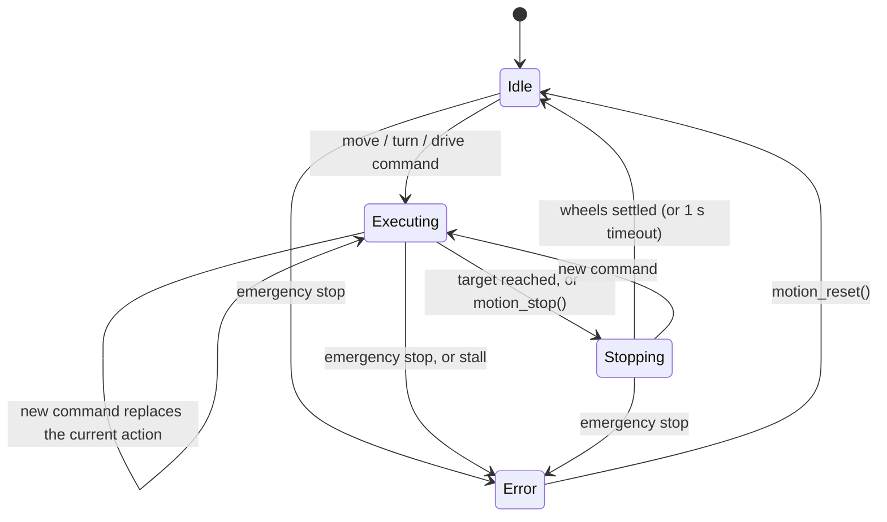

# Motion Control Statechart (matches `motion_control.c`)

States are the same four as the Week 6 Motion Control statechart: Idle, Executing Motion, Stopping, Error.

## Transitions

| From | Event | To | Action |
|---|---|---|---|
| Idle | move / turn / drive command | Executing | Reset PID, take start snapshot of wheel positions |
| Executing | New command | Executing | New start snapshot, speeds keep ramping (no jump) |
| Executing | Remaining distance or angle within tolerance plus stop-lead | Stopping | Brake both motors |
| Executing | `motion_stop()` | Stopping | Brake both motors |
| Stopping | Both wheels below 0.5 cm/s for 3 cycles, or 1 s elapsed | Idle | Clear active command |
| Stopping | New command | Executing | Reversal guard waits for wheels to stop before changing direction |
| Any | `motion_emergency_stop()` | Error (fault ESTOP) | Brake and latch immediately, drop queued command |
| Executing | Motor driven at 25 % duty or more but wheel under 0.5 cm/s for 500 ms | Error (fault STALL) | Brake and latch, drop queued command |
| Error | Movement command | Error | Rejected with `MOTION_ERR_FAULT` |
| Error | `motion_reset()` | Idle | Unlatch motors, clear fault |

## Assumptions

- `motion_update()` runs every 20 ms from the Motion Control task.
- The count sign of each wheel is its last driven direction (one encoder phase per wheel).
- Only the Safety Monitor and the Vehicle Controller call the API; neither touches the motors directly.
