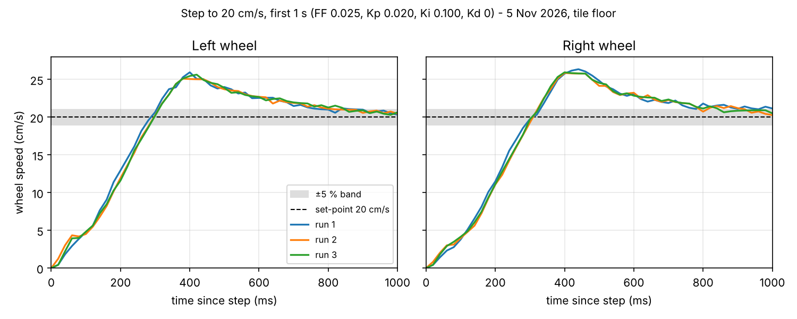

# PID Tuning Report — Motion Control (Buddy 2)

Team 08, INF2004. Author: Afiq.
Status: **partly measured on 5 Nov 2026** (open-loop sweep, brake test and a 20 cm/s step test on the car). The gains were **not re-tuned or re-measured** after the feed-forward correction, and the straight-line, 10/30 cm/s and low-battery tests were **not run**. Sections 8 and 10 say exactly what is and is not covered.

## 1. Purpose

Tune the wheel speed controller in `motion_control.c` so each wheel holds a commanded speed with little overshoot and no sustained oscillation, across the battery range the car will see in the demo.

## 2. Controller

Per wheel, every 20 ms:

```
duty = FF * setpoint + PID(setpoint, measured_speed)
duty = at least MOTION_MIN_DUTY in magnitude (stiction), limited to -1..1
```

- Measured speed comes from encoder counts, low-pass filtered (`MOTION_SPEED_FILTER_ALPHA`).
- PID has a clamped integrator and derivative on the measurement.
- Set-points ramp with limited acceleration and deceleration.
- Straight-line correction trims the two wheel set-points from the left/right distance mismatch.

Starting values (all placeholders until this report is filled):

| Parameter | Config name | Start value | Final value |
|---|---|---|---|
| Feed-forward (duty per cm/s) | `MOTION_FEEDFORWARD_DUTY_PER_CM_S` | 0.025 | 0.013 (from the duty sweep; not re-measured) |
| Kp | `MOTION_PID_KP` | 0.020 | 0.020 (unchanged) |
| Ki | `MOTION_PID_KI` | 0.100 | 0.100 (unchanged) |
| Kd | `MOTION_PID_KD` | 0.000 | 0.000 (unchanged) |
| Integral limit | `MOTION_PID_INTEGRAL_LIMIT` | 0.30 | 0.30 (unchanged) |
| Minimum duty | `MOTION_MIN_DUTY` | 0.15 | 0.15 (unchanged; both wheels already move at duty 0.10) |
| Straight-line Kp | `MOTION_STRAIGHT_KP` | 1.5 | 1.5 (not tuned) |
| Acceleration (cm/s²) | `MOTION_ACCEL_CM_S2` | 60 | 60 (not tuned) |
| Deceleration (cm/s²) | `MOTION_DECEL_CM_S2` | 80 | 80 (not tuned) |
| Stop lead (s) | `MOTION_STOP_LEAD_S` | 0.03 | 0.045 (brake test, 3 runs) |
| Maximum speed (cm/s) | `MOTION_MAX_SPEED_CM_S` | 40 | 65 (full duty gives 73 to 77) |
| Encoder edge mode | `MOTION_ENCODER_EDGE_MODE` | 1 | 3 (both edges, see section 3) |

## 3. Measured constants (team measurements)

| Item | Value |
|---|---|
| Wheel diameter | 6.5 cm |
| Wheel gap (tyre centre to tyre centre) | 12.2 cm |
| Counts per wheel turn, left | 12658 / 10 = 1265.8 |
| Counts per wheel turn, right | 12685 / 10 = 1268.5 |
| Distance per count | about 0.0161 cm |
| Encoder edge counted during that test | Both edges (confirmed by the check below) |

**Encoder edge check (5 Nov 2026).** The firmware was set to count one edge (`MOTION_ENCODER_EDGE_MODE` 1) while the constants above were counted on both edges. Turning each wheel by hand for 5 full turns gave `countL` = 3162 and `countR` = 3178, about 632 and 636 counts per turn instead of about 1266. The firmware therefore saw half the real distance and speed. `MOTION_ENCODER_EDGE_MODE` was changed to 3 (both edges). After the change the same hand check was reported to be in the expected range (about 6330 left and 6340 right after 5 turns; the exact counts were not recorded).

All results below were measured **after** this change. The first duty sweep, brake test and step test were taken with edge mode 1, were in the wrong units (speeds and distances half of the real values) and were discarded.

## 4. Test set-up

- Battery state: full to half, the same for all runs (the source was not recorded).
- Surface: tile floor.
- Date: 5 Nov 2026.
- Firmware: `motion_bench`, built from `test/bench/CMakeLists.txt`. Output was copied from the VS Code Serial Monitor at 115200 baud. Raw CSV files were not archived, so the tables below come from the logged output.
- Wheels off the ground for the open-loop tests (`d`, `k`).

## 5. Step 1 — plant identification (open loop)

Duty sweep (`d`), wheels off the ground, edge mode 3:

| Duty | Left (cm/s) | Right (cm/s) |
|---|---|---|
| 0.10 | 6.92 | 6.15 |
| 0.20 | 15.12 | 14.33 |
| 0.30 | 23.23 | 22.17 |
| 0.40 | 31.23 | 29.44 |
| 0.50 | 39.31 | 36.38 |
| 0.60 | 47.51 | 43.87 |
| 0.70 | 55.82 | 51.63 |
| 0.80 | 63.58 | 59.64 |
| 0.90 | 71.24 | 67.35 |
| 1.00 | 77.39 | 73.28 |

From the table:

- Dead zone (lowest duty that moves both wheels): **below 0.10**. Both wheels already move at 0.10, and the 0.1 step size cannot resolve it. `MOTION_MIN_DUTY` stays at 0.15, which is above the dead zone.
- Maximum speed at full duty: **77.4 cm/s (left) and 73.3 cm/s (right)** → `MOTION_MAX_SPEED_CM_S` set to 65 (about 10 % margin).
- Slope of the linear part: a straight-line fit gives 0.0126 (left) and 0.0133 (right) duty per cm/s, about 0.0129 to 0.0131 for both together (fit quality R² above 0.999) → `MOTION_FEEDFORWARD_DUTY_PER_CM_S` set to **0.013**. The previous default, 0.025, was about twice the measured value.
- Left/right mismatch at the same duty: the right wheel is slower by **6.6 % on average** (11 % at duty 0.10, about 5 % at higher duty). The straight-line correction and the PID must absorb this.

## 6. Step 2 — brake test

`k` run 3 times (wheels off the ground, duty 0.6). Speed and coast distance are the average of the two wheels.

| Trial | Speed before brake (cm/s) | Distance after brake (cm) | Lead (s) |
|---|---|---|---|
| 1 | 45.6 (L 47.32, R 43.83) | 2.05 (L 1.97, R 2.12) | 0.045 |
| 2 | 45.4 (L 47.20, R 43.67) | 2.06 (L 1.97, R 2.14) | 0.045 |
| 3 | 45.3 (L 47.01, R 43.53) | 2.06 (L 1.97, R 2.14) | 0.045 |

Chosen `MOTION_STOP_LEAD_S`: **0.045** (the three runs agree to the third decimal).

## 7. Step 3 — closed-loop tuning

The manual one-gain-at-a-time procedure was **not carried out**. Only the step test (`t`, 20 cm/s for 3 s, then stop) was run, three times, with the starting gains Kp 0.020, Ki 0.100, Kd 0 and the old feed-forward 0.025. The feed-forward was then corrected from the duty sweep; the corrected value has not been run on the car.

Tuning log (left wheel / right wheel):

| Run | FF | Kp | Ki | Kd | Rise time (s) | Overshoot (%) | Settling time (s) | Steady-state error (cm/s) | Notes |
|---|---|---|---|---|---|---|---|---|---|
| 1 | 0.025 | 0.020 | 0.100 | 0 | 0.215 / 0.220 | 29.8 / 31.8 | 0.90 / 1.06 | -0.001 / -0.078 | FF about twice the measured value |
| 2 | 0.025 | 0.020 | 0.100 | 0 | 0.241 / 0.245 | 25.5 / 29.3 | 0.86 / 0.94 | 0.030 / 0.152 | |
| 3 | 0.025 | 0.020 | 0.100 | 0 | 0.234 / 0.240 | 28.2 / 29.8 | 0.86 / 0.86 | 0.008 / 0.038 | |
| 4 | 0.013 | 0.020 | 0.100 | 0 | not run | | | | corrected FF, not re-measured |
| 5 | | | | | not run | | | | |

Definitions: rise time = 10 % to 90 % of the set-point; overshoot = (peak − set-point) / set-point; settling time = time to stay within ±5 % of the set-point; steady-state error = mean(set-point − speed) over the last second (2.0 to 3.0 s) of the step. Speed ripple (standard deviation over the same second) was 0.19 to 0.26 cm/s (left) and 0.23 to 0.29 cm/s (right).

The speed peaked at about 25 to 26 cm/s, about 0.4 s after the step, then settled to 20 cm/s. The figure below shows the first second of all three runs.



Not measured: 10 and 30 cm/s, and low battery (all runs used the same full-to-half battery).

## 8. Step 4 — straight-line correction

**Not tested.** The 100 cm straight runs (5 trials) and the `MOTION_STRAIGHT_KP` tuning were not done, so no sideways drift figures exist.

For reference only: the step test uses `motion_drive` (no straight-line correction). The firmware heading changed by +0.53°, −2.04° and −0.53° over the three runs (about 60 cm each). This is the firmware's own estimate, not a measured drift.

## 9. Acceptance targets (proposed — the team must confirm these)

| Metric | Target |
|---|---|
| Overshoot at 20 cm/s | under 10 % |
| Settling time at 20 cm/s | under 0.8 s |
| Steady-state error at 20 cm/s | under 1 cm/s |
| Speed ripple (standard deviation, steady state) | under 1.5 cm/s |
| Sideways drift over 100 cm | under 2 cm |
| Performance at low and high battery | all of the above met |

## 10. Final gains and results

Results below are from the three runs with the **old feed-forward (0.025)**, the last configuration that was measured.

| Metric | Result | Target met? |
|---|---|---|
| Overshoot | 25.5 to 31.8 % | No |
| Settling time | 0.86 to 1.06 s | No |
| Steady-state error | at most 0.15 cm/s | Yes |
| Speed ripple | std dev 0.19 to 0.29 cm/s | Yes |
| Drift over 100 cm | not tested | Not tested |

Values now in `motion_config.h`: feed-forward 0.013, stop lead 0.045, maximum speed 65, edge mode 3. Kp, Ki and Kd are unchanged. Because the feed-forward error explains the overshoot, the corrected value is expected to reduce it, but this **has not been measured**, so the overshoot and settling targets are still unproven.

## 11. Conclusions and limitations

- **What worked:** the duty-to-speed relationship is very linear (R² above 0.999), the brake test is very repeatable, and steady-state error and ripple were far inside the targets. Speed tracking at 20 cm/s is stable and the three runs agree closely.
- **What was hard:** the encoder edge mode did not match the calibration constants, so every distance and speed was half of the real value until it was found with the hand-turn check. The old feed-forward was also set for the wrong units.
- **Open items:** the corrected feed-forward is untested; 10 and 30 cm/s, low battery, the straight-line correction and the drift test were not done; raw serial logs were not archived; the battery source was not recorded.
- **Left/right mismatch:** the right wheel is about 7 % slower at the same duty, which is why the straight-line correction is needed.
- **Encoder:** one phase per wheel means no direction sensing; with a quadrature (two-phase) encoder direction and resolution would improve.
- **Battery:** the effect of battery level was not measured.
