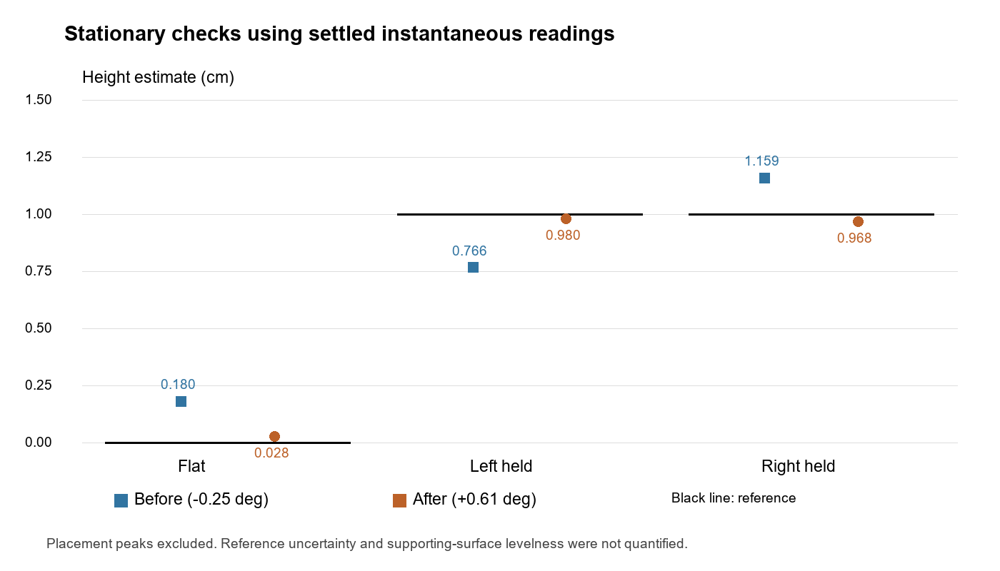
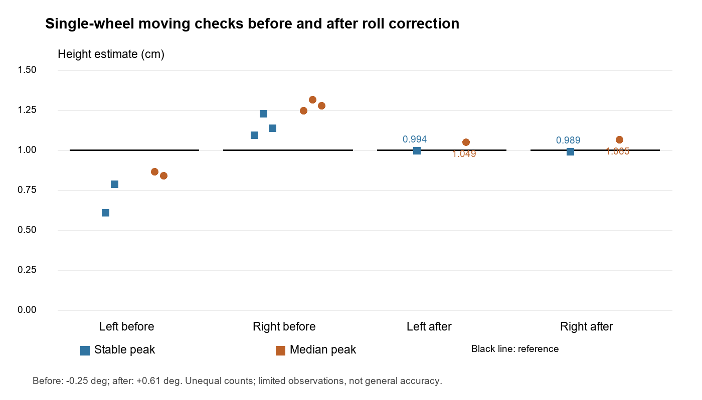

# Buddy 4 Terrain Analysis Report Draft

Project: INF2004 Autonomous PicoCar  
Evidence checkpoint: 2 November 2026 (height captures from 28 October retained)

Status: Evidence-backed working draft; final team integration, rubric review and broader validation remain pending.

Current source ownership, fresh test/build results and native integration blockers
are documented in [HANDOVER.md](HANDOVER.md). Hardware measurements below come
from preserved captures or are explicitly attributed to the operator; this
documentation work performed no robot operation. No algorithm/calibration changed.

## 1. Purpose and scope

Buddy 4 implements IMU acquisition and calibration, tilt and terrain detection, preliminary hump-height estimation, motion classification, possible-impact logging, and estimated turn rate. The implementation provides reusable processing modules and separate standalone and driving-test applications.

The operator's course setup raises one wheel on a ramp while the opposite wheel
remains on the lower surface. The operator measured the smaller test ramp as
1.0 cm. This is an external nominal reference, not a height embedded in the
algorithm. Course/rubric announcements still require their original references
for a final submission; this draft does not independently audit those requirements.

## 2. Hardware and processing architecture

The robot uses a Raspberry Pi Pico W and an LSM303D accelerometer/magnetometer. Initial identification established address 0x1D and WHO_AM_I value 0x49. The device has no gyroscope. I2C0 uses GP16 for SDA and GP17 for SCL, with a 3.3 V supply and common ground.

The accelerometer operates at 100 Hz with a +/-2 g range; application processing runs approximately every 20 ms. Signed 16-bit little-endian readings are converted using 0.000061 g/count. Sensor axes are preserved rather than reassigned from printed board arrows.

Buddy 2 supplies motor control and encoder data; Buddy 3 supplies line-following decisions. Buddy 4 exposes processing outputs. The integration_test application combines these modules under a cooperative Pico SDK scheduler. This test application is distinct from the final micro-T-Kernel application, which remains pending. Manual ramp tests bypass line-following steering and therefore do not demonstrate final black-line course operation.

## 3. Calibration

Each acceleration axis is corrected as follows:

    corrected_g = (uncorrected_g - bias_g) * scale

| Axis | Bias, g | Scale |
|---|---:|---:|
| X | 0.03799 | 1.01301 |
| Y | 0.03790 | 1.03419 |
| Z | 0.08411 | 1.01223 |

These are preliminary six-position estimates because orientations were imperfectly aligned. Raw counts and uncorrected values remain available in standalone logging. Corrected acceleration drives angle, magnitude and transient processing.

Current mounting offsets are 0.97 degrees for pitch and 0.61 degrees for roll, with positive signs for both channels. There is no automatic startup zeroing: the system must not redefine a starting slope as level.

The roll offset was previously -0.25 degrees. Two flat recordings averaged +0.913 and +0.800 degrees. The code subtracts the mounting offset, so the proposed correction was:

    -0.25 + (0.913 + 0.800) / 2 = 0.6065 degrees

This was rounded to 0.61 degrees, rebuilt, flashed by the operator, and checked in stationary and moving tests. Supporting-surface levelness was assumed; its uncertainty was not quantified.

Wheel centre spacing is measured as 11.3 cm. Earlier values referred to inner tyre gap, outer width, or a provisional midpoint. Buddy 2 retains 12.2 cm in its geometry configuration; team reconciliation is pending.

## 4. Tilt and hump processing

Pitch and roll are filtered using alpha 0.15. Pitch enters uphill/downhill at +/-6 degrees and returns toward flat at +/-3 degrees. Roll enters a side state at +/-4 degrees and returns toward side-level at +/-2 degrees. Negative roll denotes left-wheel-up; positive roll denotes right-wheel-up.

These labels describe chassis orientation. The accelerometer cannot independently distinguish one wheel rising from the opposite wheel dropping. Caster contact and combined pitch/roll also affect the chassis.

The preliminary geometric model is:

    wheel_height_difference_cm = 11.3 * sin(abs(filtered_roll))

Angles must be converted to radians for the sine calculation. The result estimates wheel-height difference, not an independently observed surface height. It cannot recover general obstacle height when both wheels rise equally.

Two event-peak estimators run alongside each other. The original stable estimator requires at least 200 ms of fresh observations with absolute-roll variation no greater than 1 degree and adjacent gaps no greater than 40 ms. The experimental estimator retains the highest accepted median of 11 filtered absolute-roll samples spanning 190-210 ms, again requiring strictly increasing timestamps and gaps no greater than 40 ms.

Validity flags distinguish an unconfirmed estimate from a measured zero. Placement movement may create historical peaks much larger than the settled position, so held-position analysis uses settled instantaneous readings rather than stored event maxima.

## 5. Experimental results

### 5.1 Reference and procedure

The ramp reference height was reported as 1.00 cm. Manual driving targets were
3.0 cm/s per wheel. The operator described centred placement under the selected
tyre, the opposite wheel on flat ground and unassisted moving crossings.
Stationary recordings were described as motor-power-off and unsupported.
These physical protocol details are operator provenance, not independently
observable from CSV alone.

Incomplete CSV fragments were excluded rather than interpreted with shifted columns. Complete logged rows are observations, not necessarily independent module updates. Numerical summaries below refer to the previously reviewed captures; original files should accompany the submission where appropriate.

### 5.2 Before the roll-offset correction

| Trial | Stable peak, cm | Median peak, cm |
|---|---:|---:|
| Left 2 | 0.608 | 0.864 |
| Left 3 | 0.785 | 0.840 |
| Right 1 | 1.091 | 1.245 |
| Right 2 | 1.226 | 1.314 |
| Right 3 | 1.135 | 1.278 |

Left 1 was excluded because the operator reported the ramp was at the tyre edge rather than centred in its path. It is not counted as a detection failure.

The valid median averages were 0.852 cm left and 1.279 cm right. Together with the positive flat roll baseline, this suggested investigating mounting offset before changing height scale or detection thresholds.

### 5.3 Stationary checks after correction

| Position | Complete valid rows | Span, s | Mean roll, degrees | Mean height, cm |
|---|---:|---:|---:|---:|
| Flat | 318 | 6.42 | -0.142 | 0.028 |
| Left held at 1 cm | 373 | 7.48 | -4.977 | 0.980 |
| Right held at 1 cm | 574 | 11.46 | +4.916 | 0.968 |

All complete rows were IMU-valid with zero reported cumulative IMU errors. The left/right held estimates differed by approximately 0.012 cm. The correction substantially reduced the earlier observed asymmetry in this setup.

**Figure 1.** Settled instantaneous estimates before and after the mounting correction. Black segments show nominal references: zero for flat and 1 cm for raised-wheel positions. Recorded intervals are separate observations; surface levelness and reference uncertainty were not quantified.

### 5.4 Moving checks after correction

| Side | Complete valid rows | Stable peak, cm | Median peak, cm | Event span, s |
|---|---:|---:|---:|---:|
| Left | 458 | 0.994 | 1.049 | 1.280 |
| Right | 394 | 0.989 | 1.065 | 1.360 |

Both runs identified the correct side, confirmed both estimators, returned to side-level and stopped on the serial command. The median errors relative to nominal 1.00 cm were +0.049 cm and +0.065 cm, or +4.9% and +6.5%. Stable errors were -0.006 cm and -0.011 cm.

These are two checks, not a general accuracy specification or a controlled statistical comparison with the earlier runs. Reference-height uncertainty was not quantified. No IMU errors were reported in the complete rows. No possible-impact pulse appeared in either capture; a pre-existing cumulative impact count does not establish an entirely false-trigger-free session.

**Figure 2.** Recorded moving event peaks: squares show the stable estimator and circles show the median estimator. Black segments indicate the nominal 1 cm reference. The before-correction groups contain two valid left and three right runs; after-correction groups contain only one run per side. Invalid Left 1 is excluded. This is a limited observational comparison, not a controlled accuracy study.

### 5.5 Historical evidence boundary

The README retains earlier larger-hump and book-test summaries. Their source
captures are not indexed in the current height bundle, so their numerical
claims are not used as verified evidence for this report's conclusions. Do not
pool different calibration versions as one accuracy dataset. The manifest-backed
1 cm measurements above were rechecked against preserved files for this update.

### 5.6 Controlled possible-obstruction observations

The operator reports completion of controlled SDK tilt/terrain, one-tyre ramp,
motion classification and turning checks. The latest two original foam-test
recordings are preserved unchanged and independently parsed for recorded outputs.

| Observation | Test 1 | Test 2 |
|---|---:|---:|
| Complete 86-column rows | 722 | 669 |
| Excluded numeric fragments | 5 | 2 |
| First obstruction host timestamp | 15:42:25.084 | 15:44:36.218 |
| Obstruction count | 0 to 1 | 0 to 1 |
| Firmware event-to-SERIAL_STOP interval | 143.497 ms | 286.393 ms |
| New IMU possible-impact events | 0 | 0 |

Both logs have GRAVITY_LIKE quality in all complete rows and zero I2C errors.
At each event, forward command remains 3/3 cm/s, both measured wheel speeds are
near zero, and motor/stop faults are zero. Each event flag appears in two rows
with the same retained observation timestamp/count; this is one event per test.

The operator explicitly confirms physical foam contact in Test 1. Test 2 verifies
a second recorded possible-obstruction event; its physical contact details and
instant are not independently confirmed. Neither trial independently timestamps
contact, so contact-to-detection latency cannot be calculated. The reported
approximately 160 ms for Test 1 is event-to-first-stopped-row on the host log;
Test 2's 328 ms is event-to-host-S-send annotation. These differ from firmware
event-to-control intervals; mixed serial annotations are not a transport-latency
measurement. Exact originals, hashes, exclusions and timing definitions are in
[FOAM_SUCCESS.md](evidence/2026-11-02/FOAM_SUCCESS.md) and its manifest.

These observations support the tested SDK obstruction behavior; two selected
positive logs do not establish general sensitivity, specificity or a false-positive
rate. Earlier misses and unusable-IMU recordings remain in the evidence archive.

### 5.7 Rechecked 2 November 1 cm SDK height recordings

The five original serial recordings were subsequently identified among the
conversation uploads and analysed. They have **not yet been archived into the
tracked GitHub evidence directory**; the filename-to-condition associations below
refer to those uploads, not paths or hashes established inside this repository.
This is a separate test series from the manifest-backed 28 October results in
Sections 5.3–5.4. The operator's ramp reference was nominally 1.00 cm; physical
reference uncertainty was not quantified.

The flat recording (`Pasted text(20261102-080100).txt`) has 505 complete
86-column rows across 10.08 s, with mean *live* wheel-height difference
approximately 0.3187 cm. This nonzero flat baseline must not be silently
subtracted from other trials or treated as an independently measured level
calibration.

| Trial | Conversation-upload original | Saved stable, cm | Saved median, cm | Live maximum, cm | Interpretation |
|---|---|---:|---:|---:|---|
| Left tyre 1 | `Pasted text(20261102-080513).txt` | 1.242 | 1.312 | Not used here | Saved SIDE_EVENT_END; a byte-identical duplicate was received as `080701` |
| Left tyre 2 | `Pasted text(20261102-080853).txt` | 1.295 | 1.360 | Not used here | Saved SIDE_EVENT_END |
| Right tyre 1 | `Pasted text(20261102-081048).txt` | 0.467 | 0.640 | 0.798 | Saved SIDE_EVENT_END reports side=+1; live maximum is a distinct measurement |
| Right tyre 2 | `Pasted text(20261102-081212).txt` | Not available | Not available | 0.750 | Complete unassisted crossing reported by operator; no SIDE_EVENT_END in supplied capture |

The recorded saved values and identified live maxima are within **+/-1 cm**
of the nominal 1.00 cm reference for these limited SDK conditions. For example,
Left 2 saved-median error is +0.360 cm; Right 1 saved-stable error is -0.533 cm.
Right 2's live maximum error is -0.250 cm but **does not** establish a valid
completed peak. This is not a universal accuracy/repeatability result or proof
of detection of every physical crossing. Avoid combining saved and live values
into one accuracy statistic.

The operator reported rightward drift during left-tyre runs; tracking and
matched-wheel speed investigation belongs with Buddy 2. This does not justify
changing Buddy 4 calibration, geometry or thresholds. The current series and
earlier 28 October calibration checks have different recording conditions, so
their flat offsets should not be compared as a controlled experiment.

**Evidence follow-up:** preserve the uploaded original bytes, compute and
record SHA-256 hashes, check row exclusions and firmware provenance, and index
the series under `buddy4/evidence/` before submission. Until then, these
conversation uploads are reviewed but not repository-manifest-backed.

## 6. Motion, impact and turn-rate processing

Motion classification uses signed encoder speeds and reports STOPPED, FORWARD, REVERSE, TURNING_LEFT, TURNING_RIGHT or UNKNOWN. Selected hardware checks demonstrated forward/stopped transitions and left/right turn signs. Reverse hardware behaviour has not been established by the recorded checks.

Low opposing speeds can cancel in the mean while failing turn thresholds. UNKNOWN periods during slow turns are therefore possible and were observed. Repeated encoder timestamps must not advance confirmation.

The possible-impact signal is the norm of corrected XYZ minus a tracked XYZ
baseline, preserving horizontal changes that total acceleration magnitude can
hide. The vector reference includes gravity and slowly varying acceleration;
it is not independently measured gravity. Provisional criteria remain at least
0.30 g deviation, two or more fresh samples spanning 20 ms, gaps no greater than
40 ms, and a 500 ms cooldown plus two calm samples no greater than 0.10 g for
rearming. It is separate from bump_event and does not stop motors. Ramps,
braking, vibration and handling can resemble impact. The earlier 0.5645 g foam
peak was isolated and did not satisfy confirmation; an above-threshold normal
braking spike also remained unconfirmed. These are documented limits, not grounds
to accept all single-sample peaks.

A separate encoder-assisted POSSIBLE_OBSTRUCTION observer first requires 500 ms
of established straight forward motion under unchanged eligible demand. Both
wheel speeds must subsequently stay at or below min(0.5 cm/s, 20% of demand)
for 100 ms. It preserves only established history through a bounded 200 ms
unequal-wheel transition or a separate <=40 ms pitch-only pause; no slowdown
evidence accumulates during those transitions, and the two allowances cannot
be chained. Freshness, usable IMU, flat/level terrain context and command/motor
state constrain eligibility; stops, turns, faults, changed context or stale data
cancel. Confirmation, re-establishment and cooldown prevent repeated claims at
rest. The SDK adapter qualifies actual controller observations, not an invented
underlying encoder acquisition timestamp. This is evidence of unexpected lost
wheel rotation, not proof of collision, and it never automatically stops motors.

Encoder yaw is estimated as (right speed - left speed) / 11.3 in rad/s, then
converted to degrees/s. Positive denotes left/counterclockwise rotation.
Historical direction observations and the operator's completed turning checks
support functional sign/classification behavior. Their full raw turn captures
are not indexed here, so historical numerical averages are not presented as
newly verified measurements. No independent reference angle/time establishes
yaw accuracy or professor acceptance.

Buddy 5 can provide optional obstacle-proximity context, not proof of contact.
It is not required for the implemented encoder-assisted observation or for
initial native IMU integration. Any future fusion needs a shared timing/validity
contract and its own qualification; none is claimed here.

## 7. Software verification and remaining work

Fresh verification on 2 November 2026 passed standalone CTest 1/1, complete SDK
integration tests and the complete isolated MTK suite. Schema/formatter checks
pass for 39 standalone, 86 SDK and 17 optional MTK fields. Standalone and SDK
Pico W firmware builds verify, and the isolated `SMP=0 CONSOLE=usb_cdc` image
builds. Earlier 33/69-column recordings retain their original schema and are
never parsed as current logs. Existing Buddy 3 comparison and MTK newlib file-I/O
stub warnings remain. Evidence hashes, the original successful captures and
`git diff --check` are verified. Commands and artifact SHA-256 values are in
[HANDOVER.md](HANDOVER.md). Software checks do not establish hardware accuracy.

Remaining work includes live MTK startup/build registration, native I2C/console
review, a real Buddy 2 producer and obstruction command-context adapter, agreed
motor-safety/telemetry ownership, concurrency/course qualification, broader
collision discrimination, independent yaw accuracy and geometry reconciliation.
The isolated speed snapshot currently has no obstruction fields. See the concrete
blockers in HANDOVER.md. No production change was made to resolve these during
the documentation handover; the team must review the integration contracts.

The agreed plan defers Tribunal 1 implementation until a working integrated baseline is measured. The team must then document field ranges and minimum-bit representations, safely synchronise shared packed data, use compact binary MQTT payloads, and compare measured RAM, relevant message sizes, functionality and performance before/after. Tribunal 1 compliance is not yet established.

## 8. Draft conclusion

The rechecked 2 November 1 cm SDK recordings contain confirmed left and
right saved events, with results within +/-1 cm of the operator's nominal
reference under those conditions. Right Test 2 has a live maximum but lacks a
saved SIDE_EVENT_END in the supplied capture. The originals remain to be
archived in the repository; broader accuracy and final MTK qualification are
still pending.

The current prototype acquires calibrated acceleration and provides terrain,
motion and observational events. The fixed mounting roll correction reduced
observed asymmetry in limited 1 cm checks. Both corrected moving height trials
confirmed a single-wheel event near the operator's nominal height. Two latest
SDK logs also demonstrate possible-obstruction events before SERIAL_STOP, with
physical foam contact explicitly operator-confirmed in Test 1.

The evidence supports a working preliminary single-side height method for the tested setup. It does not establish general height accuracy, reliable collision classification, numerical yaw-rate accuracy or final integrated course performance. Those claims remain outside the demonstrated results.

## Evidence files and submission preparation

Use the Buddy 4 README as the detailed checkpoint index. Preserve original captures and document cleaning; do not manufacture raw data from these summaries. Replace this draft's pending items only when new evidence exists. Add final course/integration results, Tribunal 1 measurements and any required team report formatting before submission.

### Recording index for the latest height results

The table below indexes the **28 October** repository originals. The newer
2 November flat/left/right originals have been identified in conversation
uploads (Section 5.7), but are **not yet archived or hashed in the repository**.
Do not relabel older files or reuse their hashes for newer trials.

The [evidence index](evidence/2026-10-28/README.md) explains row selection and exclusions. The [manifest](evidence/2026-10-28/manifest.json) records original-file SHA-256 hashes, calibration versions, accepted row counts and event summaries. Raw files are preserved unchanged.

| Report observation | Original recording |
|---|---|
| Invalid Left 1, excluded | [Left 1](evidence/2026-10-28/raw/left1_invalid.txt) |
| Moving Left 2 before correction | [Left 2](evidence/2026-10-28/raw/left2_before.txt) |
| Moving Left 3 before correction | [Left 3](evidence/2026-10-28/raw/left3_before.txt) |
| Moving Right 1 before correction | [Right 1](evidence/2026-10-28/raw/right1_before.txt) |
| Moving Right 2 before correction | [Right 2](evidence/2026-10-28/raw/right2_before.txt) |
| Moving Right 3 before correction | [Right 3](evidence/2026-10-28/raw/right3_before.txt) |
| Initial flat baseline before correction | [Flat before](evidence/2026-10-28/raw/flat_before.txt) |
| Left held before correction | [Left held before](evidence/2026-10-28/raw/left_held_before.txt) |
| Right held before correction | [Right held before](evidence/2026-10-28/raw/right_held_before.txt) |
| Return to flat before correction | [Flat return](evidence/2026-10-28/raw/flat_return_before.txt) |
| Flat after correction | [Flat after](evidence/2026-10-28/raw/flat_after.txt) |
| Left held after correction | [Left held after](evidence/2026-10-28/raw/left_held_after.txt) |
| Right held after correction | [Right held after](evidence/2026-10-28/raw/right_held_after.txt) |
| Moving left after correction | [Left moving after](evidence/2026-10-28/raw/left_moving_after.txt) |
| Moving right after correction | [Right moving after](evidence/2026-10-28/raw/right_moving_after.txt) |

Historical larger-hump, book and turn results remain checkpoint summaries in this draft. Their original captures and software test artifacts are not indexed in this latest-height bundle; link them separately before claiming complete evidence traceability for the final submission. The draft still needs final report-rubric review, technical references, pending validation results and Tribunal 1 evidence.
