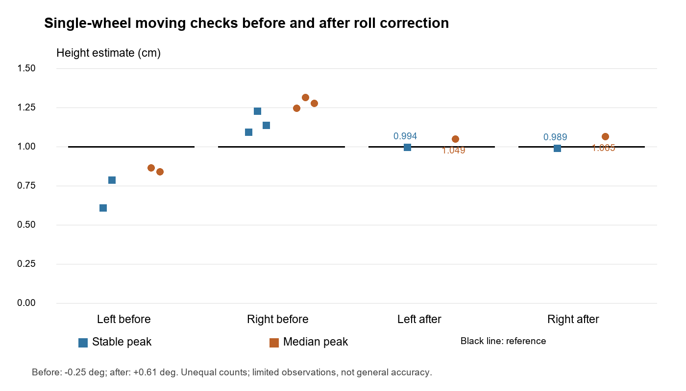
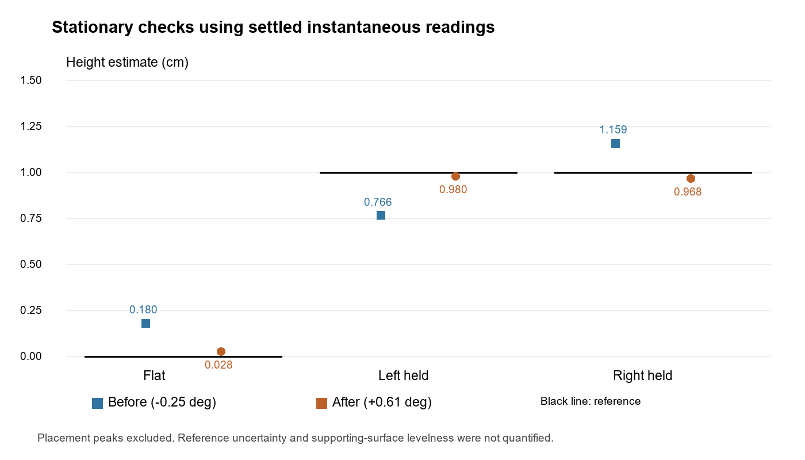

# IMU evidence checkpoint 28 October 2026

Original capture bytes are preserved in raw/. manifest.json records SHA-256 hashes, calibration versions, complete/valid row counts and extracted event summaries. All captures here use the 69-column integration schema. File labels and reference heights follow the operator's descriptions in the development session; capture timestamps are firmware times since boot, not wall-clock dates.

## Analysis rules

- Preserve raw text; do not rewrite command messages or incomplete lines.
- For numeric-row analysis accept lines beginning with a numeric sequence, exactly 69 fields, and numeric fields except motion state (index 51) and control reason (index 68).
- Select IMU-valid rows using zero-based index 3. Settled height is index 20. Recordings were supplied as settled intervals; do not infer stored event peaks are stationary measurements.
- Reject malformed rows instead of shifting columns. Rejected_numeric_lines counts numeric-prefixed rejected lines, not every non-data fragment. Terminal text is not a sample. Duplicate module timestamps are not fresh independent updates.
- Moving charts use explicit SIDE_EVENT_END summaries. Their counts and values can be checked in the manifest and original captures.
- Left 1 is excluded: ramp at tyre edge rather than centred. It is not a proven algorithmic miss.
- Heights use operator reference 1.00 cm, with unquantified measurement uncertainty. Trials are small and uneven in count. Calibration changes and repositioning prevent claims of a controlled general accuracy comparison.
- Possible-impact counts can predate captures; zero pulses in a capture do not prove zero false detections across a session.

## Figures

The latest after-correction moving stable peaks are 0.994 cm left and 0.989 cm right; median peaks are 1.049 cm left and 1.065 cm right. These support limited single-wheel verification, not collision/yaw validation or general course accuracy. No firmware changes or new robot tests were performed to prepare this evidence bundle.
